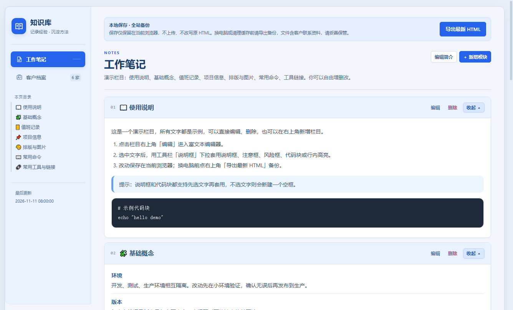
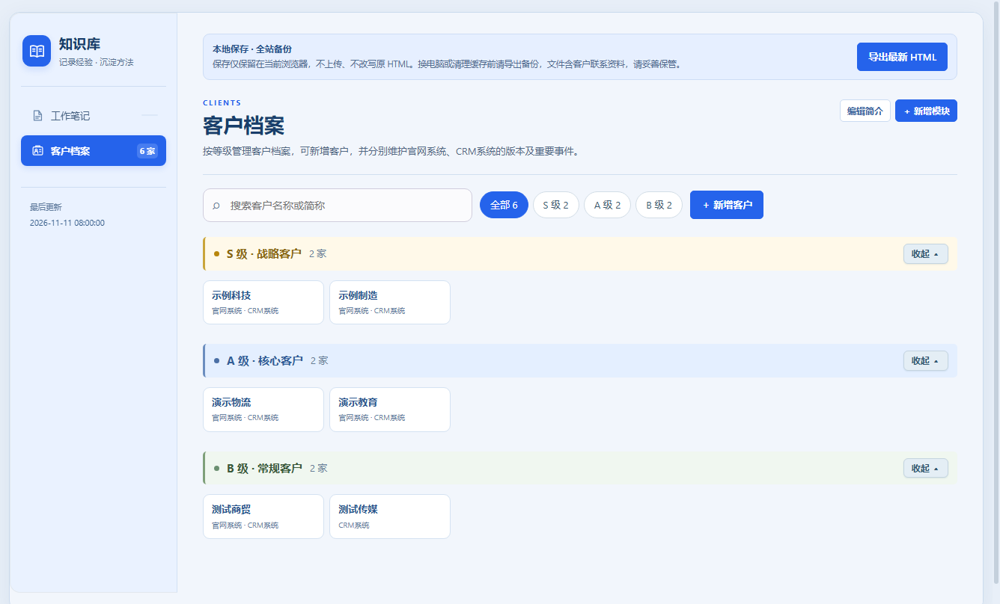
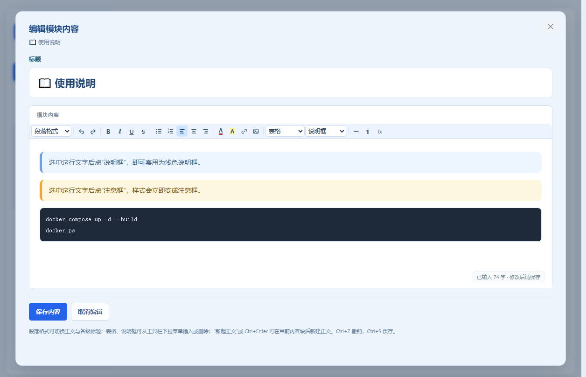

# 运维知识库 · 单文件版

一个**不需要后端、双击即用**的运维知识库与客户档案管理工具。所有数据保存在浏览器本地，可一键导出为独立的 HTML 备份文件，换电脑也能带着走。







## 功能

### 工作笔记
- 模块化管理：折叠面板、按模块生成目录锚点、拖动排序、新增 / 编辑 / 删除模块
- 富文本编辑：段落与多级标题、加粗 / 斜体 / 下划线 / 删除线、对齐、文字颜色、背景高亮、链接、图片、表格、分割线
- 说明框：说明框、注意框、风险框、代码块（黑底）、行内高亮
  - **选中文字后直接在工具栏下拉里选择样式即可套用**，也可以不选文字直接新建空框
  - 说明框之间可直接切换类型，不会嵌套
- 撤销 / 重做（含结构变化），回车自动新起普通正文段落，不继承上一个块的格式

### 客户档案
- 按 S / A / B 分级管理客户（不限行业），支持搜索与按等级筛选
- 每个客户可维护多套系统档案（示例：官网系统 / CRM 系统）：版本、信创情况、服务状态、项目负责人、重要事件、备注、图片
- 备注同样使用富文本编辑器，支持说明框、代码块等全部样式

### 数据
- 打开即用，修改自动合并到浏览器 localStorage，不依赖服务器
- 「导出最新 HTML」会把当前全部内容与档案写入一个独立 HTML 副本，用于备份或迁移
- 支持外部 HTML 备份文件的导入合并

## 快速开始

1. 下载本仓库的 [`index.html`](index.html)
2. 双击用 Chrome / Edge 打开即可

无需安装、无需联网、无需任何依赖。

## 数据存储与隐私

- 数据仅保存在**当前浏览器**的 localStorage 中，不会上传到任何服务器
- 存储键包含文件路径，不同文件副本的数据互不影响
- 清除浏览器数据、更换浏览器或换电脑前，请先点击右上角「导出最新 HTML」备份
- 本仓库中的 `index.html` 只包含**演示用测试数据**：6 家虚构公司（示例科技、示例制造、演示物流、演示教育、测试商贸、测试传媒）和示例栏目（使用说明、基础概念、值班记录、项目信息等），不含任何真实客户信息

## 项目结构

```
.
├── index.html              # 单文件应用（含演示数据）
├── docs/
│   ├── preview-notes.png
│   ├── preview-clients.png
│   └── preview-editor.png
├── README.md
└── LICENSE
```

## 技术说明

- 原生 HTML + CSS + JavaScript，单文件、零依赖、零构建
- 富文本基于 `contenteditable`，配合自定义工具栏、选区保存 / 恢复与结构级撤销栈
- 粘贴与导入的 HTML 会经过白名单清洗（`sanitizeKnowledgeHtml`），只保留允许的标签、类名与安全样式
- 图片以 data URL 内嵌，导出后依然可离线查看
- 响应式布局，适配桌面与窄屏

## 浏览器支持

推荐使用最新版 Chrome / Edge（完整支持本地文件存储与导出）；Firefox、Safari 基本可用。

## License

[MIT](LICENSE)
